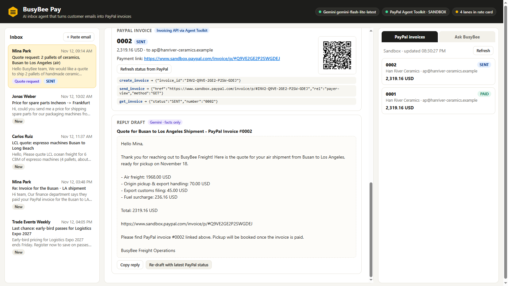
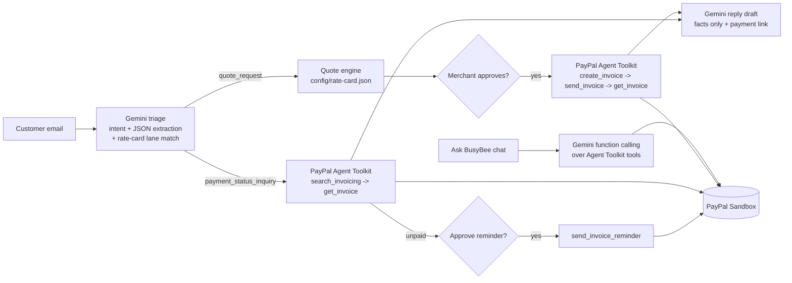

# BusyBee Pay

**An AI inbox agent that turns customer emails into PayPal invoices, payment-status answers and reminders.**

Built for the [PayPal AI Hackathon](https://paypalaihackathon.devpost.com/) with the official **PayPal Agent Toolkit** (`@paypal/agent-toolkit`, PayPal Invoicing API in the sandbox) and **Google Gemini** (free AI Studio API key).

> Demo video: _coming soon_



---

## The problem

Small freight forwarders and B2B suppliers still run sales through a shared inbox. Every day someone has to:

1. read each email and figure out what the customer wants (a quote? a payment question? spam?),
2. pull the shipment facts out of free text (route, weight, pallets, dates, who to bill),
3. price it from a rate sheet,
4. create an invoice in a billing tool and send a payment link,
5. answer "did you receive our payment?" by digging through the payment dashboard.

This is slow, error-prone, and the cash only starts moving after a human has done all five steps.

The idea comes from a real project: in the Samsung Software Academy (SSAFY) industry-partner project **BusyBee** (Samsung SDS), our team automated logistics quote and order emails, and I built the email intent classifier. What that project could not do was **close the loop with payments**. BusyBee Pay is that missing step, rebuilt from scratch for this hackathon on top of PayPal.

## What it does

| Customer email | What the agent does | PayPal capability |
| --- | --- | --- |
| **Quote request** ("2 pallets, 480 kg, Busan to LA by air, bill ap@...") | Gemini classifies the email, extracts shipment facts and matches a lane in the merchant's rate card. A deterministic engine prices it from `config/rate-card.json`. After one-click approval, the agent creates and sends a **PayPal invoice** with itemized lines and drafts a reply containing the payment link. | `create_invoice`, `send_invoice`, `get_invoice`, `generate_invoice_qr_code` |
| **Quote request with missing data** ("price for spare parts Incheon to Frankfurt") | Detects which quantities the matched lane needs (derived from the rate card's charge bases) and drafts a reply asking only for those. No invoice is created. | – |
| **Payment status question** ("our finance team paid, can you confirm?") | Searches PayPal for the customer's invoices (billing email, sender email, invoice number), reads the live status and payment details, and drafts a factual reply. If the invoice is still unpaid it proposes a **PayPal reminder** for approval. | `search_invoicing`, `get_invoice`, `send_invoice_reminder` |
| **Anything else** (newsletters, spam) | Marked "no action". | – |

Plus:

- **PayPal invoices panel** – live list of sandbox invoices and statuses (`list_invoices`).
- **Ask BusyBee** – a chat agent where Gemini calls PayPal Agent Toolkit tools itself (function calling): *"Which invoices are still unpaid?"*, *"Did Sol Coffee pay?"*, *"Send a reminder for the oldest unpaid invoice."* Read tools run immediately; **write tools (reminders, cancellations) are queued for human approval**.
- **Paste any email** into the inbox to try your own text.

## How it works



Design choices:

- **AI where judgment is needed, code where money is computed.** Gemini reads, classifies, extracts and writes. Prices come only from the merchant's rate card (`config/rate-card.json`) through a deterministic engine (`src/quote.js`), so the model never invents a number.
- **Human-in-the-loop for every write.** Creating/sending invoices and sending reminders always need a click. Read-only PayPal lookups run automatically.
- **Facts-only replies.** Reply drafts are generated from a `FACTS` block (quote lines, PayPal invoice number, status, payment link) returned by PayPal, not from model memory.
- **Structured output.** Gemini is called with a JSON Schema (`responseJsonSchema`) so the triage result is always machine-readable.
- **One toolkit, two ways.** The same PayPal Agent Toolkit tools power the approved workflow (called directly, validated with the toolkit's own zod schemas) and the chat agent (exposed to Gemini as function declarations).

### Tech

- Node.js 20+, Express, vanilla HTML/CSS/JS (no build step)
- [`@paypal/agent-toolkit`](https://www.npmjs.com/package/@paypal/agent-toolkit) 1.11 – PayPal Invoicing + Transaction Search APIs (sandbox)
- Google Gemini API (`gemini-3.5-flash`, automatic fallback to `gemini-flash-lite-latest` when busy) – structured output + function calling
- Everything runs locally; state is a JSON file in `data/runtime/`

## Run it yourself

### 1. Prerequisites

- **Node.js 20 or newer**
- **A free Gemini API key**: https://aistudio.google.com/apikey (free tier is enough)
- **PayPal sandbox REST credentials** (free):
  1. Log in at https://developer.paypal.com/dashboard/ (any PayPal account; sign-up is free).
  2. Go to **Apps & Credentials**, make sure the **Sandbox** toggle is on, click **Create App** (type: Merchant) and copy the **Client ID** and **Secret**.
  3. Under **Testing Tools → Sandbox Accounts** you will find a sandbox **Personal** account. Open it (**View/Edit account**) to see its email/password; you use it to pay invoices in the sandbox.

### 2. Install and configure

```bash
git clone https://github.com/HyunjoJung/busybee-pay.git
cd busybee-pay
npm install
cp .env.example .env      # Windows PowerShell: Copy-Item .env.example .env
```

Fill in `.env`:

```dotenv
GEMINI_API_KEY=your-gemini-key
PAYPAL_CLIENT_ID=your-sandbox-client-id
PAYPAL_CLIENT_SECRET=your-sandbox-secret
PAYPAL_ENVIRONMENT=SANDBOX
```

Check the setup (calls Gemini once and requests a PayPal sandbox OAuth token):

```bash
npm run check
```

### 3. Start

```bash
npm start
# open http://localhost:3000
```

## Testing guide (about 5 minutes)

1. **Quote → PayPal invoice.** Select *"Quote request: 2 pallets of ceramics, Busan to Los Angeles (air)"* and click **Analyze with AI**. You will see the intent, the extracted shipment facts, the matched lane and the itemized quote. Click **Approve & send PayPal invoice**. The invoice is created and sent in your PayPal sandbox; the card shows its number, status `SENT`, the payment link, a QR code and the reply draft.
2. **Pay it as the customer.** Open the payment link, log in with your **sandbox Personal account** and pay (sandbox money only). Back in BusyBee Pay, click **Refresh status from PayPal**: the status becomes `PAID` with the payment date.
3. **Payment question.** Select *"Re: Invoice for the Busan - LA shipment"* and click **Analyze with AI**. The agent looks the invoice up in PayPal and drafts a reply confirming the payment (or proposes a reminder if it is still unpaid).
4. **Missing information.** Analyze *"Price for spare parts Incheon -> Frankfurt"*: the agent asks only for the quantities that lane needs.
5. **Agent chat.** Approve the *Sol Coffee* quote too (leave it unpaid), then open **Ask BusyBee** and ask *"Which invoices are still unpaid? Send a reminder for the oldest one."* You will see the PayPal tool calls; the reminder waits for your **Approve** click.
6. **Your own email.** Use **+ Paste email** to try any text (e.g. a quote for 3 pallets, 750 kg, Los Angeles to Chicago by road).

Optional end-to-end script (server must be running): `npm run smoke`.

To start over, `POST /api/reset` (or delete `data/runtime/state.json`). Invoices already created stay in your sandbox.

## Customize

- `config/rate-card.json` – lanes, charge bases (`per_kg`, `per_pallet`, `per_cbm`, `per_shipment`), minimums and percentage surcharges. The engine reads everything from here; which quantities to ask a customer for is derived from the lane's charge bases.
- `config/business.json` – merchant name, reply signature, invoice terms.
- `data/sample-inbox.json` – demo emails (fictional companies, `.example` domains).
- `.env` – `GEMINI_MODEL` / `GEMINI_FALLBACK_MODELS` to switch models.

## Project structure

```
src/
  server.js     Express API + static UI
  workflow.js   email -> triage -> quote / PayPal lookup -> approval -> reply
  ai.js         Gemini prompts + JSON schemas (triage, reply, invoice note)
  gemini.js     Gemini REST client: structured output + function-calling loop
  paypal.js     PayPal Agent Toolkit wrapper (invoices, search, reminders, QR)
  agent.js      "Ask BusyBee" chat agent with approval queue for write tools
  quote.js      deterministic quote engine (rate card -> invoice lines)
  store.js      JSON-file state + activity log
public/         single-page UI
config/         rate card + merchant profile
scripts/        check-setup, smoke-test
```

## Limitations

- Emails come from the sample inbox or the paste box; Gmail/Outlook connectors are not built yet.
- Replies are drafted, not sent (the PayPal invoice email itself is sent by PayPal).
- Runs against the PayPal **sandbox**; production would also need webhook-based status updates and authentication for the UI.

## What's next

- Gmail / Outlook ingestion and one-click send of reply drafts
- PayPal webhooks (`INVOICING.INVOICE.PAID`) instead of manual refresh
- Multi-currency rate cards and partial payments / deposits
- Learning lane matches and missing-field questions from past threads

## License

[MIT](LICENSE)
